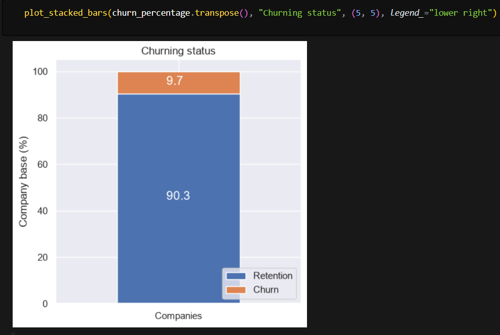
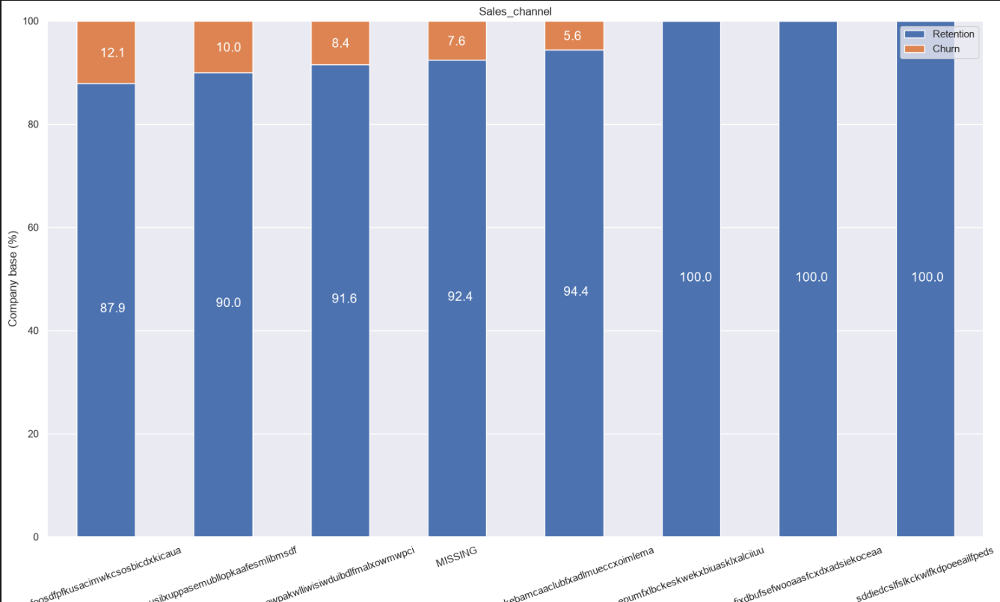
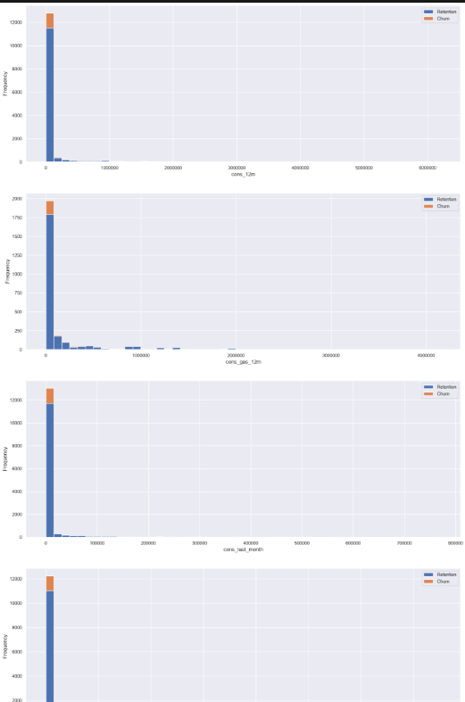
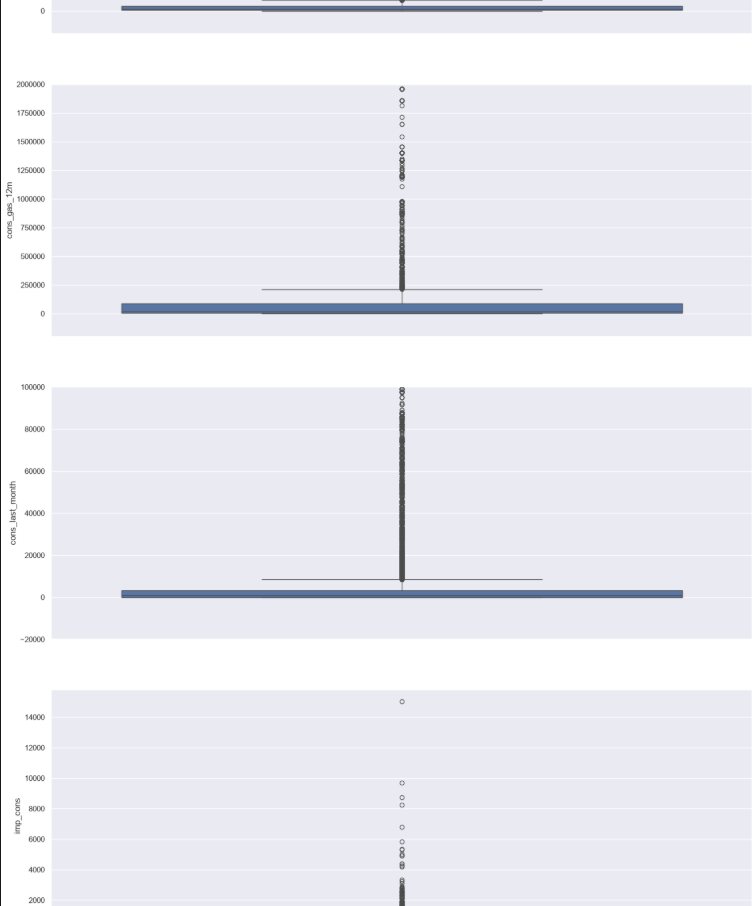
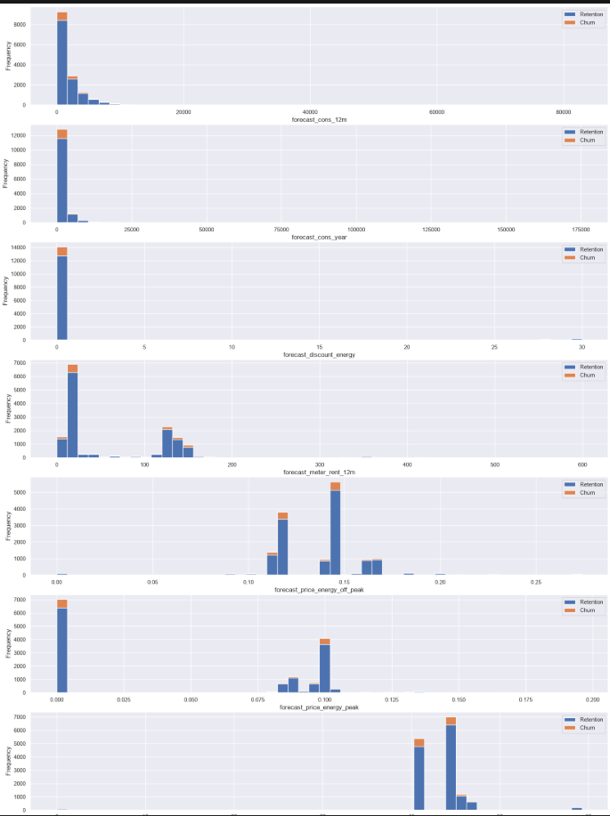
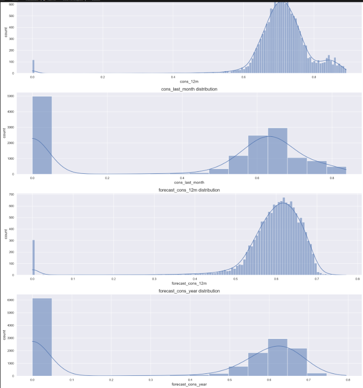
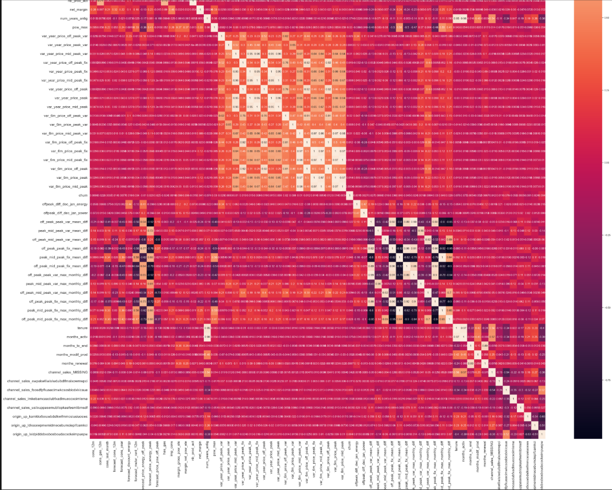
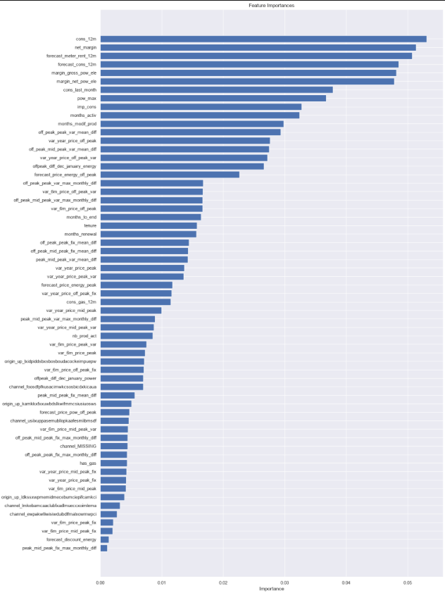

# Customer Churn Prediction | BCG X Data Science Job Simulation

> A customer-churn analysis and classification project completed as part of the BCG X Data Science Job Simulation on Forage.

## Project Overview

The goal of this project is to explore customer and pricing data for an energy company, engineer features, and train a machine-learning model to predict whether a customer will churn.

**Business question:** Can customer and pricing information help identify customers who are likely to leave their energy provider?

## Project Workflow

1. **Exploratory Data Analysis (EDA) and Data Cleaning** — inspect customer and pricing datasets, understand distributions, and explore churn patterns.
2. **Feature Engineering** — create pricing-difference and tenure-related features, encode categorical variables, and transform selected skewed numerical features.
3. **Modelling and Evaluation** — train a Random Forest classifier and evaluate its predictions on a held-out test set.

---

## 1. Exploratory Data Analysis (EDA)

The notebooks load two datasets: customer-level data and pricing data.

- **Customer dataset:** 14,606 rows and 26 columns.
- **Pricing dataset:** 193,002 rows and 8 columns.

### Churn Distribution



The target variable is imbalanced, meaning that the number of customers who churn is much smaller than the number who stay. This is important when choosing evaluation metrics.

### Churn by Sales Channel



This visualisation compares churn patterns across sales channels. Differences between groups can guide further investigation, but they do not prove that a sales channel causes churn.

### Consumption Distributions



Histograms help us understand the distributions of numerical consumption features and identify positive skewness.

### Consumption Boxplots and Potential Outliers



Boxplots help identify the spread of the data and potential outliers. These observations should be investigated rather than automatically removed.

### Churn by Contract Type



This chart compares customer churn across contract types and helps explore possible relationships between contract characteristics and customer retention.

---

## 2. Feature Engineering

Feature engineering prepares existing information for modelling and creates variables that may capture customer behaviour more effectively.

### Key Activities

- Calculated differences between January and December prices.
- Created average and maximum price-difference features across pricing periods.
- Engineered customer tenure and month-based date features.
- Encoded categorical variables, including `channel_sales` and `origin_up`.
- Filtered dummy variables for categories with fewer than 100 observations.
- Applied logarithmic transformations to selected positively skewed numerical features.
- Examined correlations between features.

### Log Transformation



Logarithmic transformations compress large values more strongly than small values and can reduce positive skewness.

A common transformation is:

`log(1 + x)`

Adding 1 allows zero values to be transformed safely. However, a log transformation does not guarantee a normal distribution, and not every machine-learning model requires normally distributed features.

### Feature Correlation Heatmap



The correlation heatmap helps examine relationships between numerical features. Strong correlations may indicate related information, but correlation does not establish causation.

---

## 3. Random Forest Modelling

A **Random Forest Classifier** was trained to predict customer churn.

### Modelling Approach

- Separated the target variable (`churn`) from the input features.
- Excluded the customer ID from the predictors.
- Split the data into 75% training data and 25% testing data.
- Trained a Random Forest classifier using `n_estimators=1000`, corresponding to 1,000 decision trees.
- Generated predictions on the test dataset.
- Evaluated the model using a confusion matrix, accuracy, precision, and recall.
- Examined feature importance to understand which variables the model relied on most.

### Random Forest Feature Importance



Feature importance helps identify variables that contribute to the trained model's predictions. It does not prove that these variables cause customers to churn.

---

## 4. Model Evaluation

The recorded test-set results from the modelling notebook are:

| Metric | Result |
|---|---:|
| Accuracy | 90.33% |
| Precision | 80.95% |
| Recall | 4.64% |

### Interpretation

- **Accuracy:** The model correctly classified approximately 90.33% of test observations overall.
- **Precision:** Of the customers predicted to churn, approximately 80.95% actually churned.
- **Recall:** The model identified only approximately 4.64% of the customers who actually churned.

Although accuracy and precision appear high, recall is very low. This means the model missed most customers who actually churned.

Since identifying customers at risk of leaving is central to churn prevention, accuracy alone is not sufficient to assess the model's business value.

### Confusion Matrix Results

| Outcome | Count |
|---|---:|
| True Negatives | 3,282 |
| False Positives | 4 |
| False Negatives | 349 |
| True Positives | 17 |

These results assume that `1` represents churn and `0` represents non-churn.

---

## 5. Potential Improvements

- Investigate class imbalance and compare class weighting or resampling techniques.
- Tune Random Forest hyperparameters using cross-validation.
- Compare the model against a baseline and other suitable classifiers.
- Evaluate precision, recall, F1-score, and alternative prediction thresholds.
- Consider the business cost of missed churners versus false alarms.
- Keep the test set separate from model and threshold selection.
- Check preprocessing for data leakage and validate the pipeline on unseen data.

---

## 6. Tools and Technologies

- **Python** — programming and analysis
- **Pandas and NumPy** — data manipulation
- **Matplotlib and Seaborn** — data visualisation
- **Scikit-learn** — machine-learning modelling and evaluation
- **Jupyter Notebook** — experimentation and analysis

---

## 7. Repository Structure

```text
BCG-X-Customer-Churn-Prediction/
│
├── README.md
├── images/
│   ├── churn_distribution.png
│   ├── churn_by_sales_channel.png
│   ├── consumption_distributions.png
│   ├── consumption_boxplots.png
│   ├── churn_by_contract_type.png
│   ├── log_transform_distributions.png
│   ├── feature_correlation_heatmap.png
│   └── random_forest_feature_importance.png
│
├── Task 1- eda_data_cleaning.ipynb
├── Task 2-feature_engineering.ipynb
└── Task 3_modeling.ipynb
```

*Note: Update the notebook filenames in this structure if your actual filenames differ.*

---

## 8. Key Learnings

Through this project, I gained practical experience in:

- Performing exploratory data analysis on customer datasets.
- Identifying skewness and potential outliers.
- Engineering pricing and date-related features.
- Encoding categorical variables for machine learning.
- Training and evaluating a classification model.
- Interpreting confusion matrices and classification metrics.
- Understanding why high accuracy can be misleading for imbalanced datasets.
- Using feature importance to investigate model behaviour.

---

## Acknowledgement

This project was completed as part of the **BCG X Data Science Job Simulation on Forage**, providing practical experience in applying data science techniques to a customer churn prediction problem.